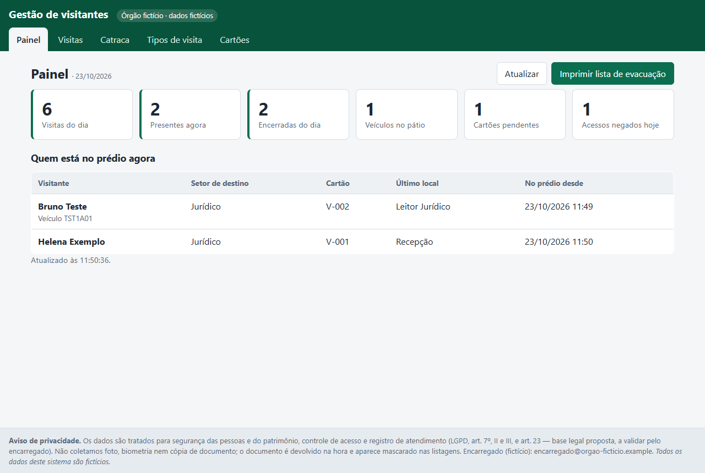
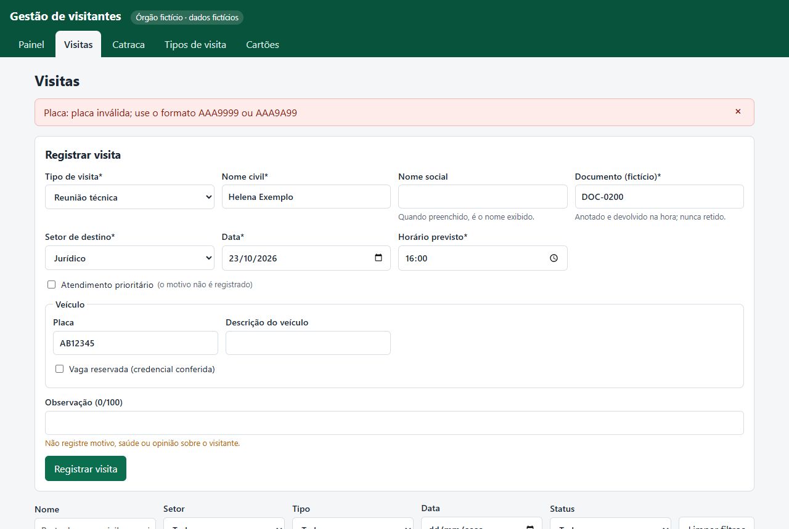
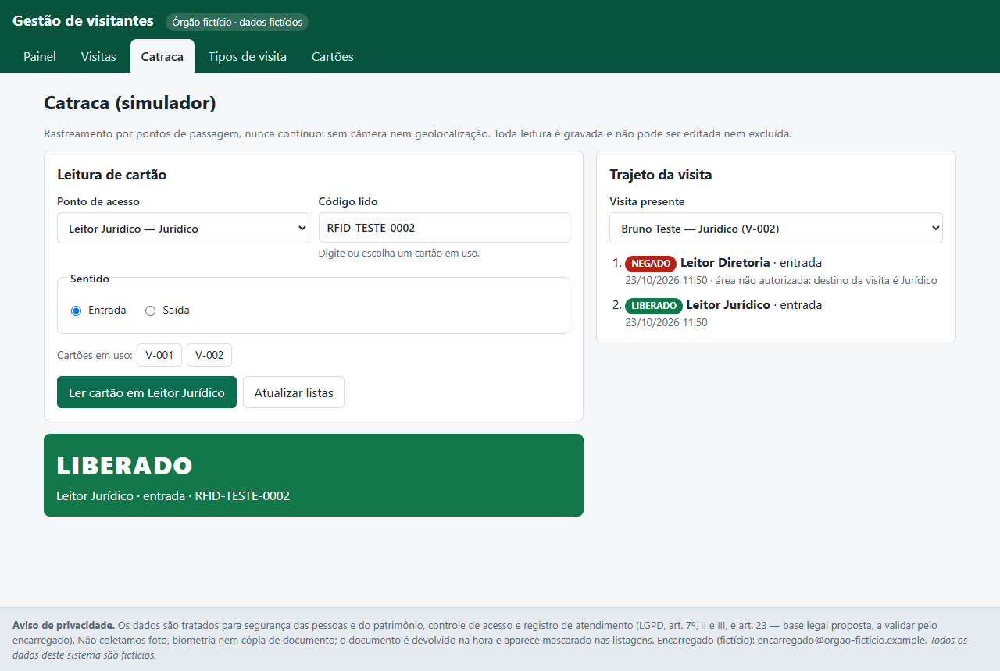
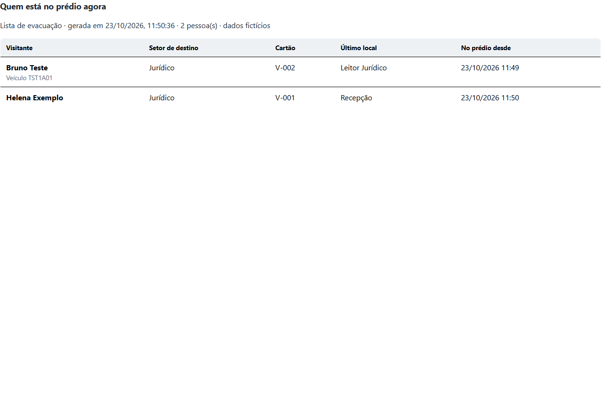
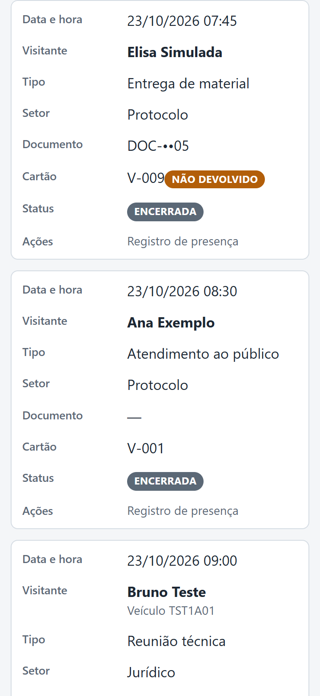

<p align="center">
  
</p>

<h1 align="center">Gestão de visitantes</h1>

<p align="center">
  <strong>Recepção de um órgão público fictício: visitas por tipo, cartão de acesso, catraca simulada e lista de evacuação</strong><br>
  <em>Tipos de visita configuráveis · Entrada e saída com cartão · Rastreamento por pontos de passagem · Painel do dia · LGPD por padrão · Dados 100% fictícios</em>
</p>

<p align="center">
  <a href="https://gestao-visitantes.vercel.app"></a>
  <a href="https://www.python.org/"></a>
  <a href="https://fastapi.tiangolo.com/"></a>
  <a href="https://react.dev/"></a>
  <a href="https://supabase.com/"></a>
  <a href="#-instalação"></a>
  <a href="#-testes"></a>
  <a href="CHANGELOG.md"></a>
  <a href="#-privacidade-e-segurança"></a>
</p>

<p align="center">
  <a href="https://gestao-visitantes.vercel.app"></a>
</p>

<p align="center">
  <a href="https://gestao-visitantes.vercel.app"><strong>🌐 Abrir a demo</strong></a> •
  <a href="#️-veja-em-ação"><strong>🖼️ Veja em ação</strong></a> •
  <a href="#-instalação"><strong>⚡ Instalar</strong></a> •
  <a href="#-uso-rápido"><strong>🚀 Usar</strong></a> •
  <a href="CHANGELOG.md"><strong>📋 Novidades</strong></a> •
  <a href="https://github.com/Yiuky/gestao-visitantes/issues/new"><strong>🐞 Relatar problema</strong></a> •
  <a href="#-english-abstract"><strong>🌐 English</strong></a>
</p>

---

<p align="center">
  
</p>

## 📌 O que faz

Uma portaria que controla visitantes em papel não consegue responder três perguntas:

1. **Quem está no prédio agora, e onde?** É o dado crítico numa evacuação.
2. **Quais crachás não voltaram?**
3. **Alguém entrou numa área não autorizada?**

O **Gestão de visitantes** responde a essas perguntas para a recepção de um órgão público **fictício**:
- a visita é **registrada** conforme um tipo configurável;
- na entrada, a recepção **entrega um cartão de acesso**;
- o cartão gera **passagens** nas catracas e nos leitores, que montam o **trajeto** e a **lista de evacuação**;
- na **saída**, o sistema confirma a devolução do cartão.

Um **painel** mostra os indicadores do dia, todos calculados no banco.

> Projeto **pessoal e independente** de Joberth Firmino Gambati, desenvolvido no Desafio 06 da Formação Claude Code
> (Engenharia de Software Agêntica). Não é um produto oficial de nenhuma instituição nem fala em nome dela.
> **Todos os dados são fictícios:** órgão, pessoas, documentos (`DOC-…`), placas (`TST…`) e cartões (`RFID-TESTE-…`).

## 🌐 Acesso online

| | Endereço |
|---|---|
| **Aplicação (Vercel)** | **https://gestao-visitantes.vercel.app** |
| Documentação da API (Swagger) | https://gestao-visitantes.vercel.app/docs |
| API (Render) | https://gestao-visitantes-api.onrender.com |
| Banco (Supabase) | PostgreSQL gerenciado, sem acesso público, com RLS em todas as tabelas |

> [!WARNING]
> **Ambiente de demonstração, sem autenticação.** **Não insira dados reais**: nomes, documentos, placas ou qualquer
> informação pessoal. Os registros são fictícios e podem ser apagados ou reiniciados a qualquer momento. No plano
> gratuito do Render, a primeira requisição depois de um período sem uso pode levar cerca de 50 s.

## 🖼️ Veja em ação

As imagens abaixo foram capturadas em **https://gestao-visitantes.vercel.app** por
[`scripts/capturas.mjs`](scripts/capturas.mjs), que clica nos botões reais da tela e confere cada resultado.

### Formulário que se adapta ao tipo de visita

<p align="center">
  
</p>

O documento vira obrigatório quando o tipo exige, e o bloco de veículo só aparece quando o tipo permite. Os erros da
API aparecem em destaque, em português.

### Entrada com cartão de acesso

<p align="center">
  
</p>

A entrada só aceita um cartão **disponível** e uma visita **do dia**. Se outra recepção usar o mesmo cartão enquanto
o modal está aberto, a API recusa e a tela avisa.

### Catraca simulada e trajeto

<p align="center">
  
  &nbsp;
  
</p>
<p align="center"><em>Leitor de outro setor: NEGADO, com motivo. Leitor do setor de destino: LIBERADO, e o último local é atualizado.</em></p>

### Lista de evacuação e celular

<p align="center">
  
  &nbsp;
  
</p>
<p align="center"><em><strong>Imprimir lista de evacuação</strong> imprime só a lista (<a href="docs/img/online/lista-evacuacao.pdf">PDF de exemplo</a>). Abaixo de 640 px, as tabelas viram cartões.</em></p>

## ✨ Recursos

| | |
|---|---|
| 🗂️ **Tipos de visita configuráveis** | Documento obrigatório, veículo permitido, setores permitidos, ativar e desativar; as regras valem na criação e na edição |
| 📝 **Visitas** | Registrar, pesquisar (nome civil ou social, setor, tipo, data, status), editar, cancelar e excluir; prioritários primeiro no mesmo horário |
| 🪪 **Cartão de acesso** | Entrada só com cartão disponível e na data da visita; na saída, o cartão que não voltou fica **EXTRAVIADO** |
| 🚧 **Catraca simulada** | Toda leitura é gravada como LIBERADO ou NEGADO, com motivo; passagens **não se editam nem se apagam** |
| 🧭 **Rastreamento por pontos** | Trajeto da visita em ordem e **último local** de cada presente; nunca contínuo, sem câmera nem geolocalização |
| 📊 **Painel** | Visitas do dia, presentes, encerradas, veículos no pátio, cartões pendentes e acessos negados, todos por `COUNT` no banco |
| 🖨️ **Lista de evacuação** | "Quem está no prédio agora", com impressão limpa |
| 🔒 **LGPD por padrão** | Documento mascarado (`DOC-••01`), nome social exibido, prioridade sem motivo, sem foto e sem biometria |
| 📱 **Responsivo** | De 360 px ao desktop; modais próprios, sem `alert`/`confirm` do navegador |
| 🐳 **Docker e nuvem** | `docker compose` local; Vercel + Render + Supabase online |

## 💻 Requisitos

| Modo | Requisitos |
|---|---|
| **Demo online** | Só um navegador: https://gestao-visitantes.vercel.app |
| **Docker** | Docker Desktop (ou Docker Engine) com Compose |
| **Local** | Python 3.11+ e Node 18+ (Windows, Linux ou macOS) |

## ⚡ Instalação

### Docker (recomendado)

```powershell
docker compose build
docker compose up -d --wait                    # http://localhost:8080  (Swagger em /docs)
docker compose run --rm api python seed.py     # opcional: dados fictícios
docker compose --profile test run --rm tests   # testes dentro do contêiner
docker compose down                            # para (use -v para apagar o volume de dados)
```

### Local (Windows / PowerShell)

```powershell
# API
cd backend
python -m venv .venv; .\.venv\Scripts\Activate.ps1
pip install -r requirements.txt
python seed.py                    # opcional: dados fictícios
uvicorn app.main:app --reload     # http://127.0.0.1:8000/docs

# Front (outro terminal)
cd frontend
npm install
npm run dev                       # http://localhost:5173 (proxy /api → :8000)
```

> [!NOTE]
> Se o `pytest` acusar `DLL load failed while importing _sqlite3`, o `python` do PATH pode ser o embutido em outro
> programa, sem o SQLite. Crie o venv com outro interpretador, por exemplo
> `uv venv --managed-python --python 3.12 .venv` e `uv pip install -r requirements.txt`.

### Na nuvem (Vercel + Render + Supabase)

1. **Supabase:** crie o projeto e copie *Connect › Session pooler* (IPv4), acrescentando `?sslmode=require`.
   Se a senha tiver símbolos, codifique-os na URL (`@` → `%40`, `#` → `%23`…).
2. **Render:** *New › Blueprint* com este repositório ([render.yaml](render.yaml)) e informe `DATABASE_URL`.
3. **Vercel:** importe o repositório com *Root Directory* = `frontend` ([vercel.json](frontend/vercel.json)).
4. **Dados de exemplo (opcional):** `$env:BASE_URL="https://<seu-app>.vercel.app"; node scripts/seed_api.mjs`.
   O script carrega o seed pela própria API, então a senha do banco não sai do Render.

Decisões e detalhes no ADR-020 de [docs/ARQUITETURA.md](docs/ARQUITETURA.md).

## 🚀 Uso rápido

| Passo | Onde | O que acontece |
|---|---|---|
| 1. Registrar | **Visitas › Registrar visita** | A visita fica **AGENDADA**; as regras do tipo são validadas |
| 2. Entrada | **Entrada** na linha da visita | Escolha um cartão disponível: a visita vai a **PRESENTE** e o cartão a **EM USO** |
| 3. Circular | **Catraca** | Escolha o ponto e o cartão: **LIBERADO** ou **NEGADO**, com o trajeto ao lado |
| 4. Saída | **Saída** na linha da visita | Informe se o cartão voltou; sem devolução, ele vira **EXTRAVIADO** |
| 5. Acompanhar | **Painel** | Indicadores do dia e "Quem está no prédio agora", com impressão |

## 🏗️ Arquitetura

```
Navegador ──► Front React + Vite (Vercel)          local: Vite :5173 ou nginx :8080
                  │  /api e /docs (rewrite: mesma origem, sem CORS)
                  ▼
             API FastAPI (Render, Docker) ── regras em services/regras.py
                  │  SQLAlchemy 2
                  ▼
          Supabase PostgreSQL + RLS          local: SQLite em backend/data/
```

| Camada | Tecnologia | Pasta |
|---|---|---|
| Front | React 18, Vite 5, CSS próprio | [frontend/](frontend) |
| API | FastAPI, Pydantic v2, SQLAlchemy 2, Uvicorn | [backend/app/](backend/app) |
| Banco | SQLite (local) · PostgreSQL/Supabase (produção) com `psycopg` 3 | `DATABASE_URL` |
| Testes | pytest + TestClient · E2E com Chrome headless via CDP | [tests/](tests) · [scripts/](scripts) |
| Contêineres | Docker (API multi-stage, web com nginx), `docker compose` | [docker-compose.yml](docker-compose.yml) |
| Deploy | Render Blueprint · Vercel | [render.yaml](render.yaml) · [frontend/vercel.json](frontend/vercel.json) |

## 🧪 Testes

```powershell
pytest -q                                          # na raiz, com o venv do backend ativo
$env:TEST_DATABASE_URL="postgres://..."; pytest -q # a mesma suíte num PostgreSQL descartável
docker compose --profile test run --rm tests       # suíte no contêiner
node scripts/capturas.mjs                          # E2E + capturas (BASE_URL padrão: http://localhost:8080)
```

| Suíte | Resultado |
|---|---|
| pytest no SQLite e no Docker | 83 passaram, 1 pulado (o teste de RLS, que só existe no PostgreSQL) |
| pytest no PostgreSQL 16, incluindo RLS | 84 passaram |
| Botões no Chrome (Visitas, Tipos, Cartões, Painel, Catraca) | 40 interações, todas aprovadas após as correções |
| E2E com capturas, local e em https://gestao-visitantes.vercel.app | 9 de 9 em cada ambiente |
| Docker (build, testes, stack, persistência por volume) | 4 de 4 |

Seis falhas reais foram encontradas e corrigidas durante o desenvolvimento, de ambiente (Python sem SQLite) a deploy
(senha com símbolos na `DATABASE_URL`). Cada uma tem causa, correção e o teste que a comprova em
[docs/EXECUCAO.md](docs/EXECUCAO.md); o mapa critério → teste → evidência está em [docs/EVIDENCIAS.md](docs/EVIDENCIAS.md).

## 🚧 Limitações

- **Sem login nem perfis** e sem trilha de auditoria de edições: não use com dados reais.
- A demo online é pública e sem autenticação; os dados podem ser alterados por qualquer visitante e reiniciados.
- A catraca é simulada; o contrato `POST /api/catraca/passagens` é o que um leitor real chamaria.
- Não há anonimização automática ao fim de `prazo_retencao_dias`.
- O plano gratuito do Render hiberna (cerca de 50 s na primeira requisição).
- Horários gravados em hora local de America/Cuiaba; uma operação em vários fusos exigiria UTC.
- Itens de produção (login, backup, anonimização) seguem no Épico A do [backlog](docs/BACKLOG.md).

## 🔐 Privacidade e segurança

| | Como o sistema trata |
|---|---|
| **Coleta mínima** | Documento mascarado nas listagens (`DOC-••01`); nome social é o nome exibido; prioridade sem motivo; vaga reservada genérica; observação de até 100 caracteres, com aviso |
| **O que não é coletado** | Foto, biometria, cópia de documento, endereço, telefone e assunto da visita |
| **Documento de identidade** | Não é retido, e o cartão nunca é entregue em troca dele (Lei 5.553/1968) |
| **Prova em incidentes** | Visitas PRESENTE e ENCERRADA não se excluem; passagens são imutáveis |
| **Rastreamento** | Por pontos de passagem, nunca contínuo; trajeto só em consulta específica |
| **Banco na nuvem** | API REST automática do Supabase desligada e RLS em todas as tabelas; um teste confere que o papel público não lê nem grava nada |
| **Segredos** | O repositório não contém senhas, tokens, `.env` nem bancos; a `DATABASE_URL` de produção existe só no Render |
| **Biometria** | Prevista no backlog como épico **bloqueado** até haver base legal específica (LGPD, art. 11), RIPD aprovado e alternativa sempre disponível |

> Os campos, a base legal e os prazos de retenção são **propostos para validação** por um encarregado de dados e
> uma assessoria jurídica. Não constituem parecer jurídico. Detalhes em [docs/LGPD.md](docs/LGPD.md).

## ❓ Perguntas frequentes

**Posso usar com dados reais?** Não. Não há login, perfis nem auditoria, e a demo é pública. O sistema existe para
demonstrar o fluxo com dados fictícios.

**Por que a demo demorou para abrir?** O plano gratuito do Render desliga a API depois de um tempo sem uso; a primeira
requisição a religa (cerca de 50 s).

**Os dados da demo somem?** Podem ser apagados ou reiniciados a qualquer momento. Para recarregar os dados de exemplo,
use `scripts/seed_api.mjs`.

**Como rodar sem internet?** Com Docker ou localmente: o banco vira um arquivo SQLite e nada sai da máquina.

## 📚 Documentação

| Documento | Conteúdo |
|---|---|
| [docs/PLANO.md](docs/PLANO.md) | Plano do MVP |
| [docs/REQUISITOS.md](docs/REQUISITOS.md) | RF, RNF, regras de negócio e critérios de aceite |
| [docs/ARQUITETURA.md](docs/ARQUITETURA.md) | Modelo de dados, endpoints e decisões (ADRs) |
| [docs/BACKLOG.md](docs/BACKLOG.md) | Sprints e épicos futuros |
| [docs/TESTES.md](docs/TESTES.md) | Casos de teste planejados |
| [docs/EXECUCAO.md](docs/EXECUCAO.md) | Log de comandos, saídas e falhas corrigidas |
| [docs/EVIDENCIAS.md](docs/EVIDENCIAS.md) | Mapa de evidências por critério |
| [docs/LGPD.md](docs/LGPD.md) | Base legal, inventário de dados e segurança |
| [CHANGELOG.md](CHANGELOG.md) | Mudanças por sprint ([Keep a Changelog](https://keepachangelog.com/pt-BR/1.1.0/)) |

## 🤝 Contribuindo

Ideias e relatos de erro são bem-vindos pelas [issues](https://github.com/Yiuky/gestao-visitantes/issues/new).
**Nunca inclua dados pessoais reais** em issues, prints ou testes. Para relatar uma falha de segurança, descreva o
problema sem credenciais nem detalhes que permitam explorá-la.

## 📝 Como citar

> Gambati, J. F. (2026). *Gestão de visitantes: MVP de recepção com cartão de acesso, catraca simulada e lista de
> evacuação* (versão 0.1.0) [Software]. https://github.com/Yiuky/gestao-visitantes

## 🌐 English Abstract

**Gestão de visitantes** (*Visitor Management*) is an MVP for the front desk of a **fictitious** Brazilian public
agency. It is a personal project built during a Claude Code training challenge, not an official system of any
institution.
- **Visits:** registered according to configurable **visit types** (required ID, vehicle allowed, allowed sectors).
- **Access cards:** handed out at check-in, and the system tracks whether each card came back at check-out.
- **Simulated turnstile:** card reads are stored as immutable, allow-or-deny **passages** with a reason. They build each
  visit's route and an **evacuation list** with every visitor's last known location.
- **Dashboard:** six indicators, all computed with `COUNT` queries in the database.
- **Privacy by design (Brazil's LGPD):** masked IDs, social name, no photo or biometrics, and presence records that
  cannot be deleted.

Stack: FastAPI, SQLAlchemy 2 and React 18/Vite. It runs on SQLite locally or on PostgreSQL in the cloud (Supabase,
with RLS), and ships with Docker, Render and Vercel configurations. The 84 pytest tests run on SQLite and PostgreSQL,
and a dependency-free E2E script drives headless Chrome over CDP. **Live demo:** https://gestao-visitantes.vercel.app
(all data is fictitious).

## 👤 Autor e licença

- **Desenvolvedor:** Joberth Firmino Gambati ([@Yiuky](https://github.com/Yiuky))
- **Licença:** ainda não definida. Sem um arquivo `LICENSE`, todos os direitos ficam reservados ao autor.
- Projetos relacionados: [ArcMagery](https://github.com/Yiuky/ArcMagery-releases) · [PRIVIO SENTRY](https://github.com/Yiuky/PrivioSentry) · [ReperIO](https://github.com/Yiuky/ReperIO)
