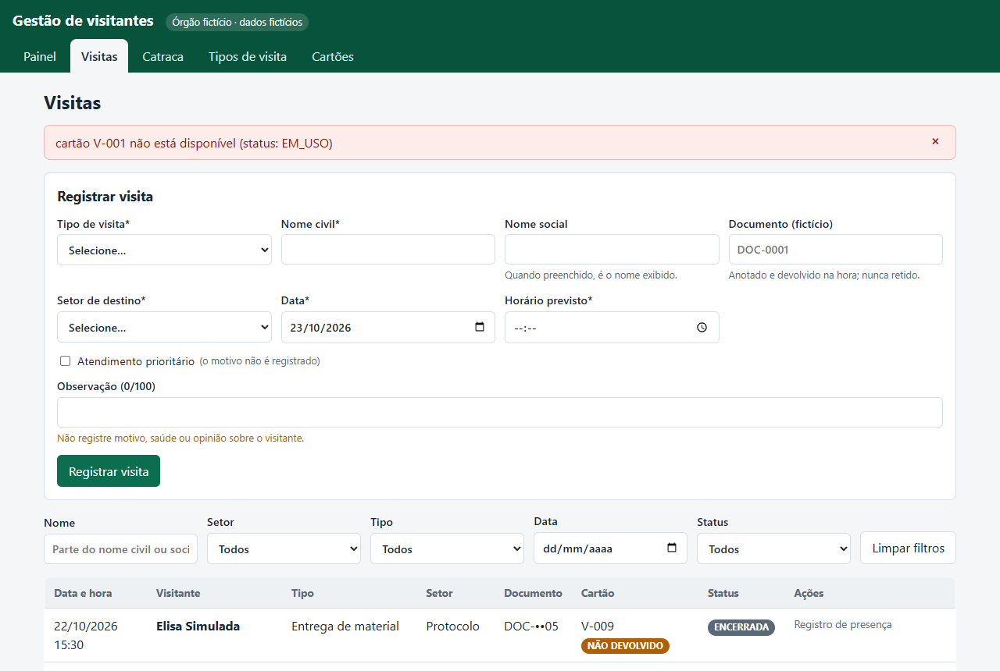
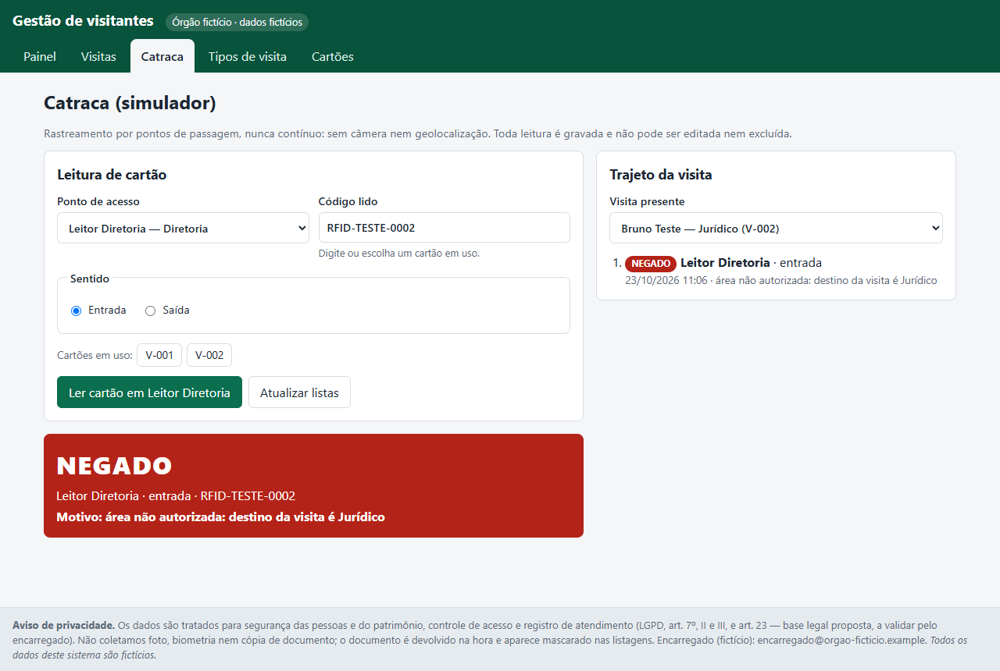
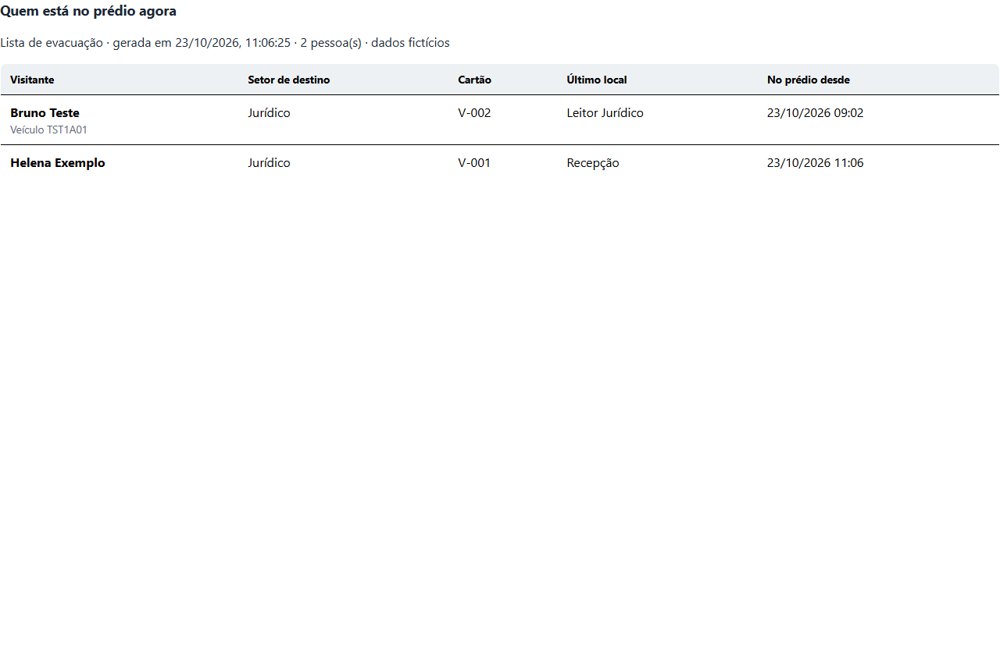
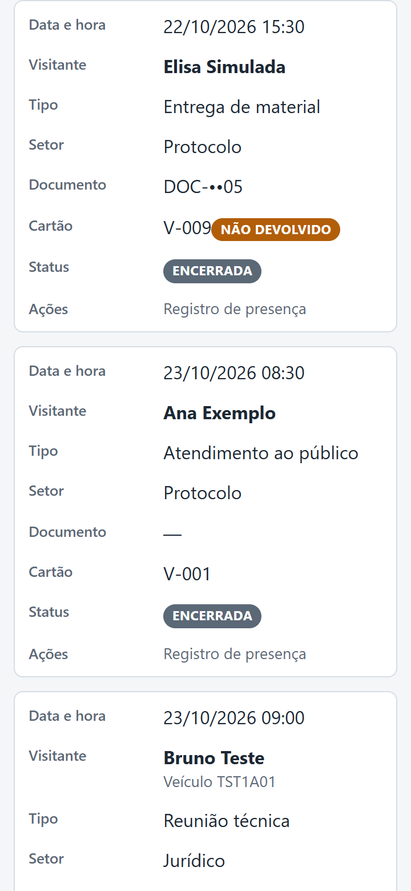

<p align="center">
  
</p>

<h1 align="center">Gestão de visitantes</h1>

<p align="center">
  <strong>Recepção de um órgão público fictício: visitas por tipo, cartão de acesso, catraca simulada e lista de evacuação</strong><br>
  <em>Tipos de visita configuráveis · Entrada e saída com cartão · Rastreamento por pontos de passagem · Painel com indicadores do dia · LGPD por padrão · Dados 100% fictícios</em>
</p>

<p align="center">
  <a href="https://gestao-visitantes.vercel.app"></a>
  <a href="https://www.python.org/"></a>
  <a href="https://fastapi.tiangolo.com/"></a>
  <a href="https://react.dev/"></a>
  <a href="https://supabase.com/"></a>
  <a href="#-instalação"></a>
  <a href="#-testes-e-resultados"></a>
  <a href="CHANGELOG.md"></a>
  <a href="#-privacidade-e-lgpd"></a>
</p>

<p align="center">
  <a href="https://gestao-visitantes.vercel.app"><strong>🌐 Abrir a demo</strong></a> •
  <a href="#️-veja-em-ação"><strong>🖼️ Veja em ação</strong></a> •
  <a href="#-instalação"><strong>⚡ Instalar</strong></a> •
  <a href="#-uso-rápido"><strong>🚀 Usar</strong></a> •
  <a href="#-testes-e-resultados"><strong>🧪 Testes</strong></a> •
  <a href="CHANGELOG.md"><strong>📋 Novidades</strong></a> •
  <a href="https://github.com/Yiuky/gestao-visitantes/issues/new"><strong>🐞 Relatar problema</strong></a> •
  <a href="#-english-abstract"><strong>🌐 English</strong></a>
</p>

---

<p align="center">
  
</p>

## 📌 O que faz

A portaria de um órgão público (fictício) controlava visitantes em papel e não sabia responder três perguntas:

1. **Quem está no prédio agora, e onde?** Dado crítico numa evacuação.
2. **Quais crachás não voltaram?**
3. **Alguém entrou numa área não autorizada?**

O **Gestão de visitantes** resolve isso com quatro passos:
- a recepção **registra a visita** conforme um tipo configurável;
- **entrega um cartão de acesso** na entrada;
- o cartão gera **passagens** nas catracas e nos leitores, e elas montam o **trajeto** e a **lista de evacuação**;
- a **saída** confirma a devolução do cartão.

Um **painel** mostra os indicadores do dia, calculados no banco.

> Projeto do **Desafio 06** (SEMA/MT · Formação Claude Code · Laboratório de Engenharia de Software Agêntica), feito
> por Joberth Firmino Gambati. **Não é um sistema oficial** de nenhuma instituição nem fala em nome dela.
> **Todos os dados são fictícios:** órgão, pessoas, documentos (`DOC-…`), placas (`TST…`) e cartões (`RFID-TESTE-…`).

## 🌐 Acesso online

| | URL |
|---|---|
| Front (Vercel) | **https://gestao-visitantes.vercel.app** |
| API (Render) | https://gestao-visitantes-api.onrender.com (Swagger em [`/docs`](https://gestao-visitantes.vercel.app/docs)) |
| Banco (Supabase) | PostgreSQL gerenciado, com RLS em todas as tabelas |
| Código | https://github.com/Yiuky/gestao-visitantes |

> [!WARNING]
> **Demonstração pública sem login** (ADR-001): qualquer pessoa com o link pode cadastrar e alterar registros.
> Use apenas dados fictícios. O plano gratuito do Render hiberna, então a primeira requisição pode levar cerca de 50 s.

## 🖼️ Veja em ação

Todas as imagens foram geradas por [`scripts/capturas.mjs`](scripts/capturas.mjs), que clica nos botões reais da tela
e confere cada resultado, sobre o seed fictício.

### Formulário que se adapta ao tipo de visita

<p align="center">
  
</p>

O documento vira obrigatório quando o tipo exige, e o bloco de veículo só aparece quando o tipo permite. Os erros da API
aparecem em destaque, em português.

### Entrada com cartão de acesso

<p align="center">
  
</p>

A entrada só aceita um cartão **disponível** e a visita do **dia**. Se outra pessoa usar o mesmo cartão enquanto o
modal está aberto, a API responde 409 e a tela avisa.

### Catraca simulada e trajeto

<p align="center">
  
  &nbsp;
  
</p>
<p align="center"><em>Um leitor de outro setor dá NEGADO, com motivo; o leitor do setor de destino dá LIBERADO e atualiza o último local.</em></p>

### Lista de evacuação e celular

<p align="center">
  
  &nbsp;
  
</p>
<p align="center"><em><strong>Imprimir lista de evacuação</strong> imprime só a lista (<a href="docs/img/lista-evacuacao.pdf">PDF de exemplo</a>). Abaixo de 640 px, as tabelas viram cartões.</em></p>

## ✨ Recursos

| | |
|---|---|
| 🗂️ **Tipos de visita configuráveis** | Documento obrigatório, veículo permitido, setores permitidos, ativar e desativar; as regras valem na criação e na edição |
| 📝 **Visitas** | Registrar, pesquisar (nome civil ou social, setor, tipo, data, status), editar, cancelar e excluir; prioritários primeiro no mesmo horário |
| 🪪 **Cartão de acesso** | Entrada só com cartão disponível e na data da visita; saída pergunta se o cartão voltou, e o que não voltou fica **EXTRAVIADO** |
| 🚧 **Catraca simulada** | Toda leitura é gravada como LIBERADO ou NEGADO, com motivo (código desconhecido, cartão fora de uso, área não autorizada…); passagens **não se editam nem se apagam** |
| 🧭 **Rastreamento por pontos** | Trajeto da visita em ordem e **último local** de cada presente; nunca contínuo, sem câmera nem geolocalização |
| 📊 **Painel** | Visitas do dia, presentes, encerradas, veículos no pátio, cartões pendentes e acessos negados, todos por `COUNT` no banco |
| 🖨️ **Lista de evacuação** | "Quem está no prédio agora", com impressão limpa |
| 🔒 **LGPD por padrão** | Documento mascarado (`DOC-••01`), nome social exibido, prioridade sem motivo, sem foto e sem biometria |
| 📱 **Responsivo** | De 360 px ao desktop; modais próprios, sem `alert`/`confirm` do navegador |
| 🐳 **Docker e nuvem** | `docker compose` local; Supabase + Render + Vercel online |

## 🏗️ Arquitetura

```
Navegador ──► Front React + Vite (Vercel)          local: Vite :5173 ou nginx :8080
                  │  /api, /docs  (rewrite: mesma origem, sem CORS)
                  ▼
             API FastAPI (Render, Docker) ── regras em services/regras.py
                  │  SQLAlchemy 2
                  ▼
          Supabase PostgreSQL + RLS          local: SQLite em backend/data/
```

| Camada | Tecnologia | Pasta |
|---|---|---|
| Front | React 18, Vite 5, CSS próprio | [frontend/](frontend) |
| API | FastAPI, Pydantic v2, SQLAlchemy 2, Uvicorn | [backend/app/](backend/app) |
| Banco | SQLite (local) · PostgreSQL/Supabase (produção) com `psycopg` 3 | `DATABASE_URL` |
| Testes | pytest + TestClient · E2E com Chrome headless via CDP | [tests/](tests) · [scripts/](scripts) |
| Contêineres | Docker (API multi-stage, web com nginx), `docker compose` | [docker-compose.yml](docker-compose.yml) |
| Deploy | Render Blueprint · Vercel | [render.yaml](render.yaml) · [frontend/vercel.json](frontend/vercel.json) |

## ⚡ Instalação

### Docker (recomendado)

```powershell
docker compose build
docker compose up -d --wait                    # http://localhost:8080  (Swagger em /docs)
docker compose run --rm api python seed.py     # opcional: dados fictícios
docker compose --profile test run --rm tests   # testes dentro do contêiner
docker compose down                            # para (use -v para apagar o volume de dados)
```

### Local (Windows / PowerShell)

Requisitos: Python 3.11+ e Node 18+.

```powershell
# API
cd backend
python -m venv .venv; .\.venv\Scripts\Activate.ps1
pip install -r requirements.txt
python seed.py                    # opcional: dados fictícios
uvicorn app.main:app --reload     # http://127.0.0.1:8000/docs

# Front (outro terminal)
cd frontend
npm install
npm run dev                       # http://localhost:5173 (proxy /api → :8000)
```

> [!NOTE]
> Se o `pytest` acusar `DLL load failed while importing _sqlite3`, o `python` do PATH pode ser o de outro programa
> (aqui era o do QGIS). Crie o venv com outro interpretador, por exemplo
> `uv venv --managed-python --python 3.12 .venv` e `uv pip install -r requirements.txt` (falha F1 em
> [docs/EXECUCAO.md](docs/EXECUCAO.md)).

### Online (Supabase + Render + Vercel)

1. **Supabase:** crie o projeto e copie *Connect › Session pooler* (IPv4), acrescentando `?sslmode=require`.
   Prefira uma senha só com letras e números; símbolos precisam ser codificados na URL.
2. **Render:** *New › Blueprint* com este repositório ([render.yaml](render.yaml)) e informe `DATABASE_URL`.
3. **Vercel:** importe o repositório com *Root Directory* = `frontend` ([vercel.json](frontend/vercel.json)).
4. **Seed (opcional):** `$env:BASE_URL="https://<seu-app>.vercel.app"; node scripts/seed_api.mjs`. O script carrega os dados fictícios pela própria API, então a senha do banco não sai do Render.

Detalhes e decisões no ADR-020 de [docs/ARQUITETURA.md](docs/ARQUITETURA.md).

## 🚀 Uso rápido

| Passo | Onde | O que acontece |
|---|---|---|
| 1. Registrar | **Visitas › Registrar visita** | A visita fica **AGENDADA**; as regras do tipo são validadas |
| 2. Entrada | **Entrada** na linha da visita | Escolha um cartão disponível: a visita vai a **PRESENTE** e o cartão a **EM USO** |
| 3. Circular | **Catraca** | Escolha o ponto e o cartão: **LIBERADO** ou **NEGADO**, com o trajeto ao lado |
| 4. Saída | **Saída** na linha da visita | Informe se o cartão voltou; sem devolução, ele vira **EXTRAVIADO** |
| 5. Acompanhar | **Painel** | Indicadores do dia e "Quem está no prédio agora", com impressão |

## 🧪 Testes e resultados

```powershell
pytest -q                                          # na raiz, com o venv do backend ativo
$env:TEST_DATABASE_URL="postgres://..."; pytest -q # mesma suíte num PostgreSQL descartável
docker compose --profile test run --rm tests       # suíte no contêiner
node scripts/capturas.mjs                          # E2E + capturas (stack no ar com o seed)
```

| Suíte | Passou | Falhou | Corrigido | Não testado |
|---|---|---|---|---|
| pytest no SQLite e no Docker | 83 (+1 pulado) | 0 | — | — |
| pytest no PostgreSQL 16 (inclui RLS) | 84 | 0 | — | — |
| Botões no Chrome via MCP (B01–B29, P01–P07, C01–C05) | 40 | 0 após correções | F2, F3, F4 | impressão via MCP (coberta pelo E08) |
| E2E com capturas (E01–E09), local | 9 | 0 após correção | F5 | — |
| E2E na URL pública ([capturas](docs/img/online)) | 9 | 0 | F6 (deploy) | — |
| Docker (D01–D04) e roteiro manual (M01–M12) | 16 | 0 | — | — |

**Falhas reais encontradas e corrigidas:**

| # | Falha | Correção |
|---|---|---|
| F1 | `pytest` com `DLL load failed while importing _sqlite3` (Python do QGIS no PATH) | venv com Python gerenciado pelo `uv` |
| F2 | Erro 409 de uma ação na tabela aparecia fora da tela | o aviso rola até ficar visível |
| F3 | Bordas da tabela desalinhadas na coluna Ações | botões num `div` dentro da célula |
| F4 | Com a API parada, a tela dizia "Erro 500" | mensagem "API indisponível" |
| F5 | Em 360 px, selos caíam na coluna do rótulo | layout do cartão refeito; o teste E09 detecta a falha |
| F6 | API no Render não subia: senha do banco com símbolos sem codificação na `DATABASE_URL` | URL montada com codificação, sem a senha sair da máquina do usuário |

Mapa completo critério → teste → evidência: [docs/EVIDENCIAS.md](docs/EVIDENCIAS.md) · log com as saídas reais: [docs/EXECUCAO.md](docs/EXECUCAO.md).

## 🔒 Privacidade e LGPD

| | Como o sistema trata |
|---|---|
| **Coleta mínima** | Documento mascarado nas listagens (`DOC-••01`); nome social é o nome exibido (Decreto MT 854/2021); prioridade sem motivo; vaga reservada genérica; observação de até 100 caracteres, com aviso |
| **O que não é coletado** | Foto, biometria, cópia de documento, endereço, telefone e assunto da visita |
| **Lei 5.553/1968** | O documento não é retido, e o cartão nunca é entregue em troca dele |
| **Prova em incidentes** | Visitas PRESENTE e ENCERRADA não se excluem; passagens são imutáveis (ADR-008) |
| **Rastreamento** | Por pontos de passagem, nunca contínuo; trajeto só em consulta específica |
| **Banco na nuvem** | RLS em todas as tabelas e Data API do Supabase desligada |
| **Biometria** | **Épico B, bloqueado** até haver base legal específica (LGPD, art. 11), RIPD aprovado e uma alternativa sempre disponível (ADR-011) |

> Os campos, a base legal e os prazos de retenção são **propostos para validação** do encarregado de dados e da
> assessoria jurídica. Não constituem parecer jurídico. Detalhes em [docs/LGPD.md](docs/LGPD.md).

## ⚠️ Limitações

- **Sem login nem perfis** (ADR-001) e sem trilha de auditoria de edições: não use com dados reais.
- A catraca é simulada; o contrato `POST /api/catraca/passagens` é o que um leitor real chamaria (ADR-012).
- Não há anonimização automática ao fim de `prazo_retencao_dias`.
- O plano gratuito do Render hiberna (cerca de 50 s na primeira requisição).
- Horários são gravados em hora local de America/Cuiaba (ADR-016); uma operação em vários fusos exigiria UTC.
- Itens de produção (login, HTTPS próprio, backup, anonimização) seguem no Épico A do [backlog](docs/BACKLOG.md).

## 📚 Documentação do projeto

| Documento | Conteúdo |
|---|---|
| [docs/PLANO.md](docs/PLANO.md) | Plano do MVP (evidência de planejamento) |
| [docs/REQUISITOS.md](docs/REQUISITOS.md) | RF, RNF, regras de negócio, critérios de aceite |
| [docs/ARQUITETURA.md](docs/ARQUITETURA.md) | Modelo de dados, endpoints e ADR-001 a ADR-020 |
| [docs/BACKLOG.md](docs/BACKLOG.md) | Sprints S0–S6 e épicos futuros |
| [docs/TESTES.md](docs/TESTES.md) | Casos de teste planejados |
| [docs/EXECUCAO.md](docs/EXECUCAO.md) | Log real de comandos, saídas e falhas corrigidas |
| [docs/EVIDENCIAS.md](docs/EVIDENCIAS.md) | Mapa de evidências por critério do desafio |
| [docs/LGPD.md](docs/LGPD.md) | Base legal, inventário de dados, segurança |
| [CHANGELOG.md](CHANGELOG.md) | Mudanças por sprint ([Keep a Changelog](https://keepachangelog.com/pt-BR/1.1.0/)) |

## 🌐 English Abstract

**Gestão de visitantes** (*Visitor Management*) is an MVP for the front desk of a **fictitious** Brazilian public
agency, built for a Claude Code training challenge (SEMA/MT).
- **Visits:** registered according to configurable **visit types** (required ID, vehicle allowed, allowed sectors).
- **Access cards:** handed out at check-in, and the system tracks whether each card came back at check-out.
- **Simulated turnstile:** card reads are stored as immutable, allow-or-deny **passages** with a reason. They build each
  visit's route and an **evacuation list** with every visitor's last known location.
- **Dashboard:** six indicators, all computed with `COUNT` queries in the database.
- **Privacy by design (Brazil's LGPD):** masked IDs, social name, no photo or biometrics, and presence records that
  cannot be deleted.

Stack: FastAPI + SQLAlchemy 2 + React 18/Vite, SQLite locally or PostgreSQL (Supabase, with RLS) in the cloud,
Docker, Render and Vercel. The test suite has 84 pytest tests (SQLite and PostgreSQL) plus a dependency-free E2E
script that drives headless Chrome over CDP. **All data is fictitious.**

## 👤 Autor

- **Desenvolvedor:** Joberth Firmino Gambati ([@Yiuky](https://github.com/Yiuky))
- **Contexto:** Desafio 06 · Formação Claude Code · SEMA/MT
- Projetos relacionados: [ReperIO](https://github.com/Yiuky/ReperIO) · [PRIVIO SENTRY](https://github.com/Yiuky/PrivioSentry)
